<p align="center">
  
</p>

<p align="center">
  <a href="https://github.com/Ledsav/volley-skills/actions/workflows/ci.yml"></a>
  
  
  
  
  
</p>

<p align="center">
  <b>A web app for volleyball clubs to track player skills, plan development,<br/>
  run physical testing sessions and build training programs, all in one place.</b>
</p>

---

**Volley Skills** replaces a per-player spreadsheet with a real tool for coaches. Each team has a
roster, and each player has a skills card, a development plan and a physical-testing history. The
club shares an exercise and training library, and every exercise can have its own court diagrams.

It is a **single-club** app built entirely on Firebase's free tier: no servers and no Cloud
Functions. Every access rule is enforced in Firestore Security Rules, and those rules have their
own test suite. Players are minors, so privacy is a first-class requirement, not an afterthought.

<p align="center">
  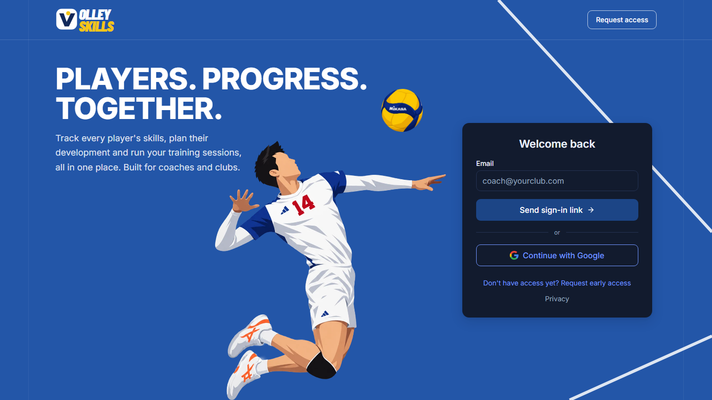
  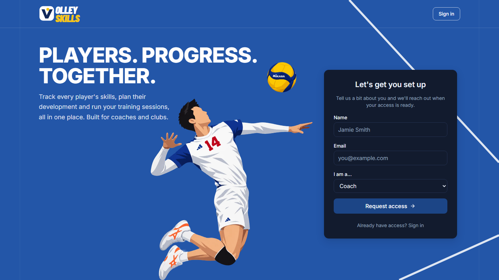
</p>

## Screenshots

<p align="center">
  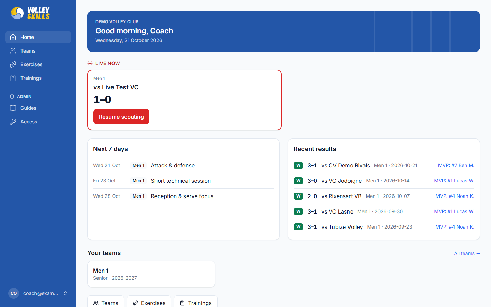
  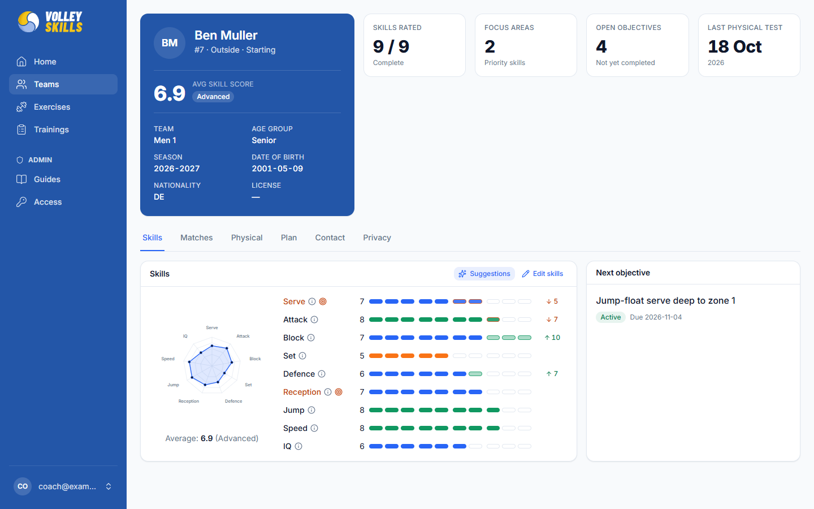
  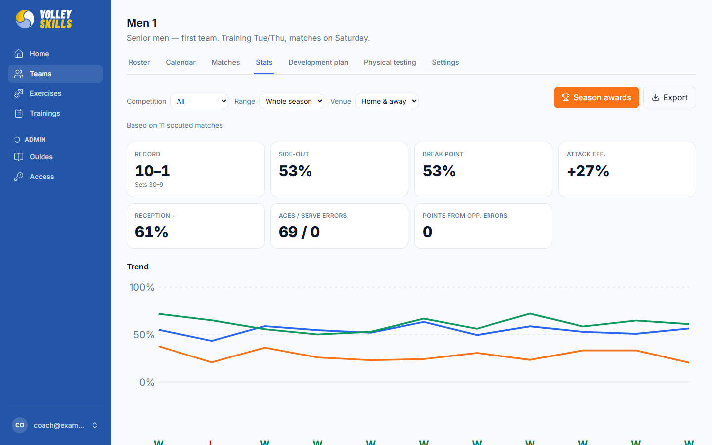
  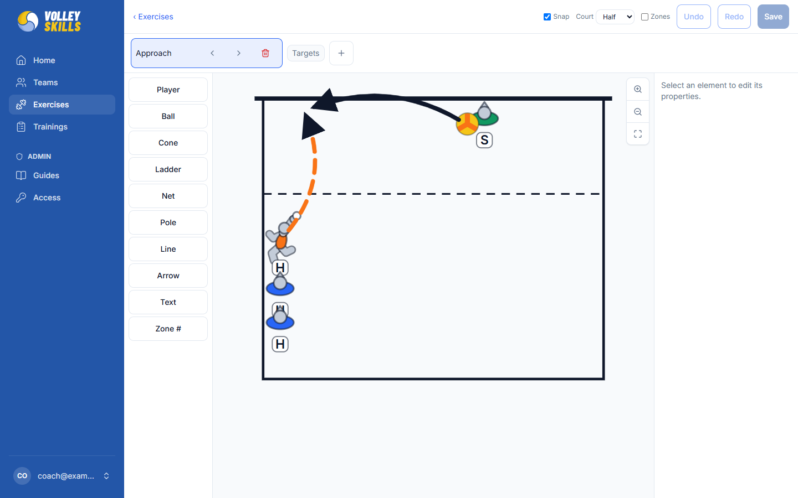
</p>
<p align="center">
  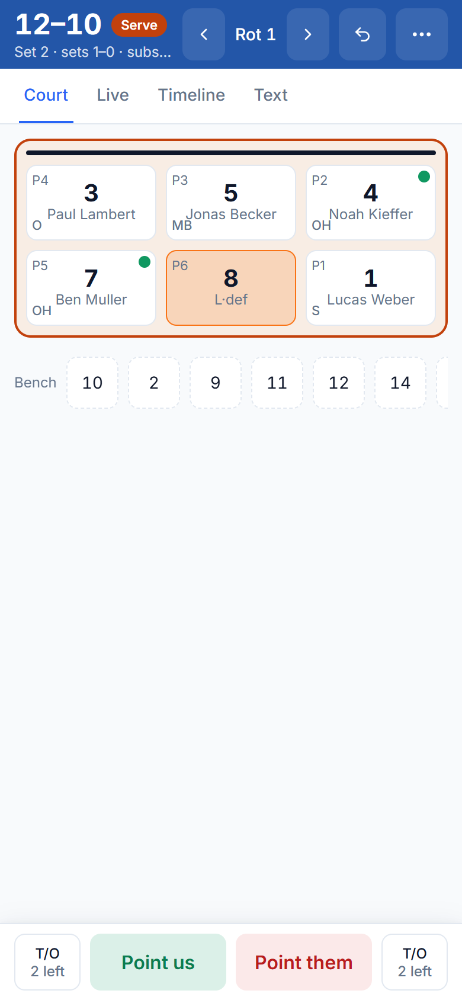
  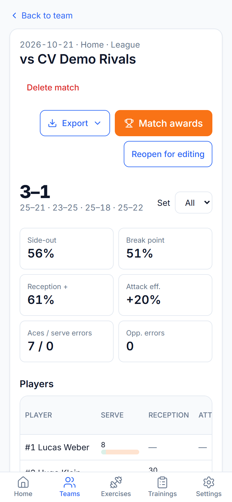
  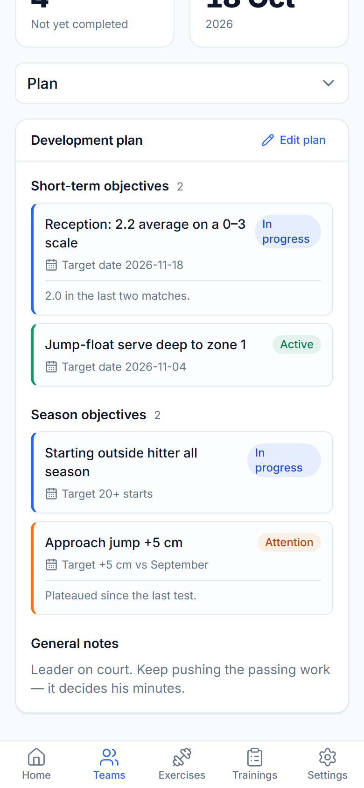
  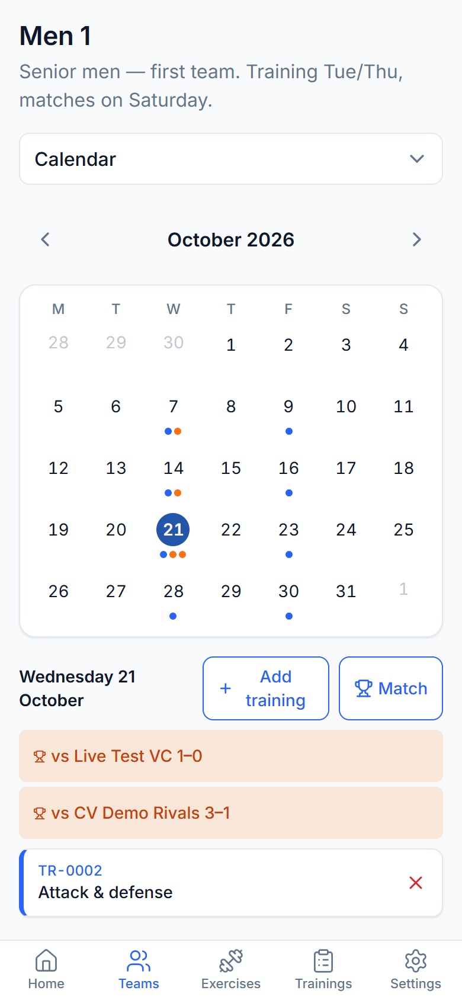
  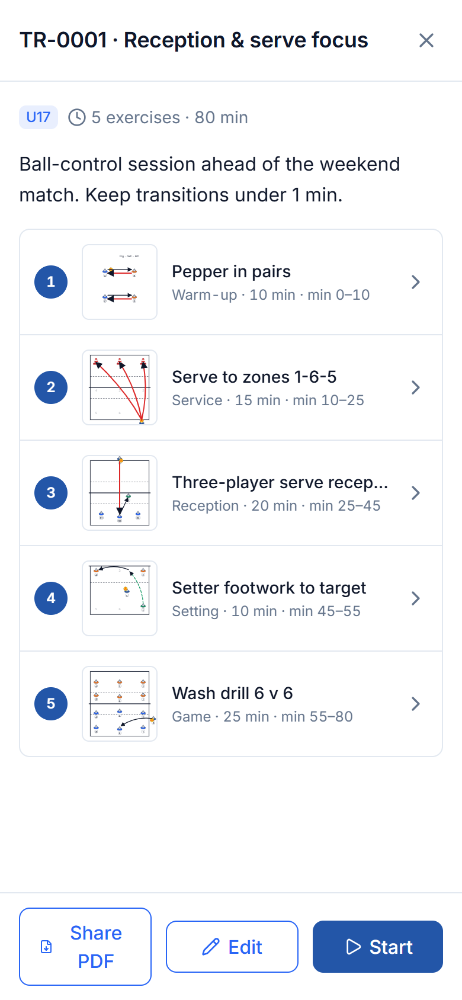
</p>

Every page at desktop and phone size is in the [screenshot gallery](docs/screenshots/README.md).
For a shareable overview of what the app does, see the
[product overview PDF](docs/marketing/volley-skills-overview.pdf).

## Features

<table>
  <tr>
    <td width="50%" valign="top">
      <h3>Teams &amp; rosters</h3>
      Teams with a lineup-ordered roster (setter, outside, opposite, middle, libero). Each row shows
      a player's skill scores, their average and a colour-coded level.
    </td>
    <td width="50%" valign="top">
      <h3>Player cards</h3>
      Contact and guardian details, 9 skills scored 1–10 with coach notes and priority flags, and a
      development plan with short-term and season-long objectives.
    </td>
  </tr>
  <tr>
    <td valign="top">
      <h3>Physical testing</h3>
      Growth, countermovement jump, approach jump, broad jump, 10 m sprint, 5-10-5 shuttle, reaction
      time and strength. <b>Live testing sessions</b> let a coach record several players at once
      from a phone in the gym, with built-in stopwatches.
    </td>
    <td valign="top">
      <h3>Exercise &amp; training library</h3>
      A shared, paginated exercise library and trainings built from ordered exercises, each with a
      sequential ID like <code>TR-0007</code>. Supports <b>bulk JSON import</b> and optional
      <b>AI drafting</b>, and a training <b>shares as a PDF</b> with one page per exercise.
    </td>
  </tr>
  <tr>
    <td valign="top">
      <h3>Court diagram builder</h3>
      A full-screen canvas editor for drawing drills: court, net, players, balls, cones, ladders,
      lines, arrows and text. Diagrams are saved as small JSON scenes and drawn as SVG wherever they
      appear.
    </td>
    <td valign="top">
      <h3>Team calendar</h3>
      A month view per team where coaches assign trainings from the shared library to dates.
    </td>
  </tr>
  <tr>
    <td valign="top">
      <h3>Live match scouting</h3>
      Scout a match from a phone in about two taps per action, with live stats and alerts during
      the match and a per-player report after it. Or type rallies in plain text and let an AI model
      turn them into events (names are swapped for shirt numbers first). Works offline.
    </td>
    <td valign="top">
      <h3>Stats &amp; awards</h3>
      A team Stats tab with filters, KPIs, trends, rotations and leaderboards (PDF/CSV export), plus
      season and match awards presented as a full-screen story and shared as images or video.
    </td>
  </tr>
  <tr>
    <td valign="top">
      <h3>Home dashboard</h3>
      Live matches to resume, the next seven days of trainings and matches, recent results with
      the MVP, and shortcuts to your teams.
    </td>
    <td valign="top">
      <h3>Phone-first</h3>
      Bottom navigation, touch-sized controls and a light and dark theme. Installable to the home
      screen.
    </td>
  </tr>
  <tr>
    <td valign="top">
      <h3>Scoped access</h3>
      Superadmins manage everything; members get access per team and per section (exercises,
      trainings, guides). Access is granted by email, so there's no user-ID lookup.
    </td>
    <td valign="top">
      <h3>Privacy by design</h3>
      Passwordless sign-in, no analytics or tracking scripts, a public privacy page, and per-player
      data export and deletion (GDPR access rights).
    </td>
  </tr>
</table>

### Skill levels

A player's average across the 9 skills maps to one of four levels. The same four colours are used
everywhere a level appears.

| Level                                                                    | Average score |
| ------------------------------------------------------------------------ | ------------- |
|      | below 4       |
|  | 4 to below 6  |
|      | 6 to below 8  |
|            | 8 and above   |

## How it fits together

A season is a loop, and every part of the app feeds the player cards.

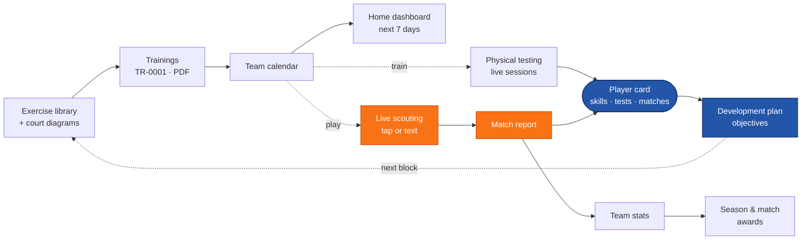

## Architecture

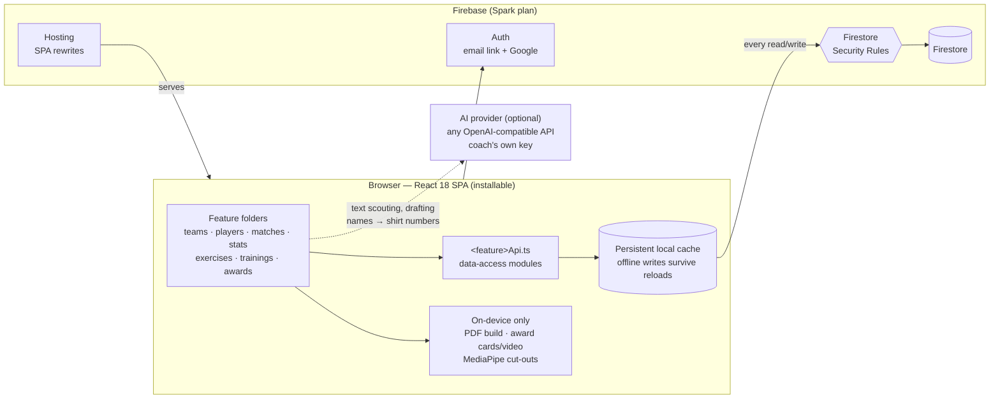

- **All authorization lives in [`firestore.rules`](firestore.rules).** Components never call
  Firestore directly; they go through the `<feature>Api.ts` modules, which return plain typed
  objects.
- **No unbounded reads.** Libraries and history timelines use `orderBy().limit()` with cursor
  pagination, and the calendar only loads the visible month. Every query has a matching index in
  [`firestore.indexes.json`](firestore.indexes.json).
- **Computed fields are saved on write, not calculated in the UI** (a player's average and level,
  a training's ID).
- **Scouting is event-sourced.** A match stores an ordered list of events, and the score, rotations
  and stats are rebuilt by replaying them (`src/matches/scoutEngine.ts`), so undo and edits are
  just event changes.
- **Photos never leave the device.** Award photos and background removal stay in memory.

### Data model

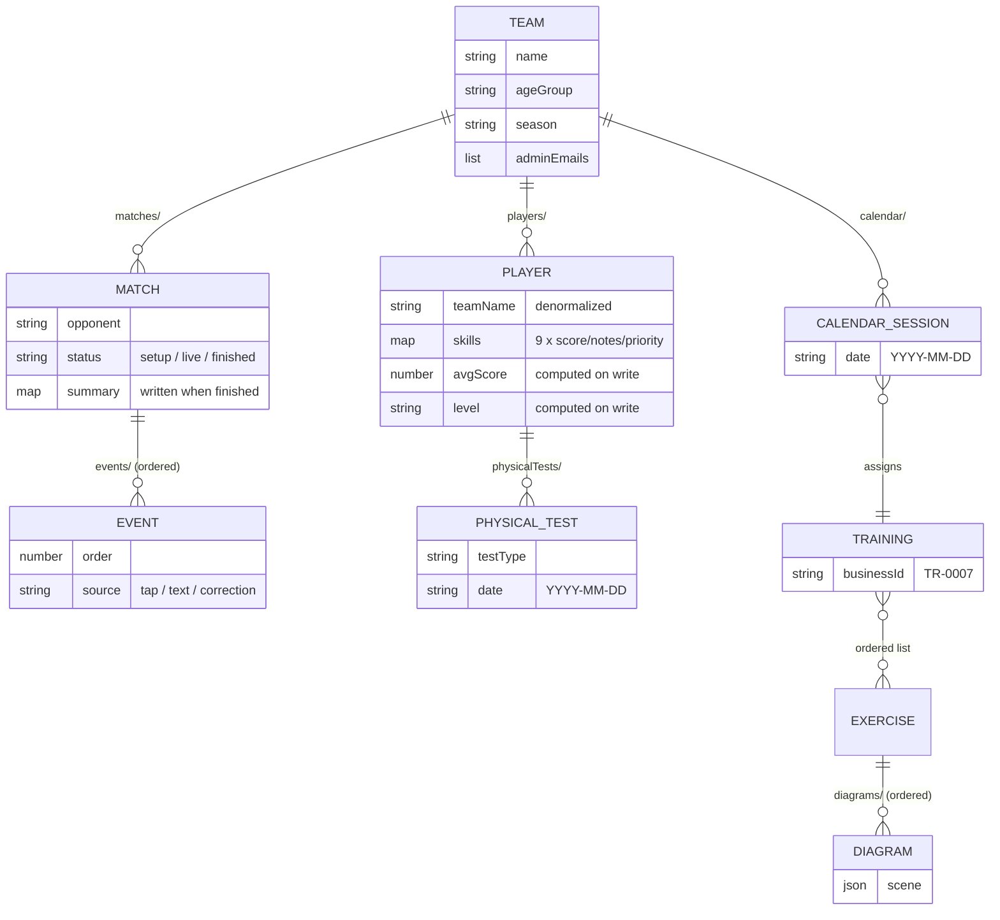

The club also has app-wide config docs: `skillGuide/config`, `physicalTestGuide/config`,
`sectionAccess/*` and `counters/trainings`. Dates are ISO `YYYY-MM-DD` strings so date ranges can
be queried directly. The full contract is in the
[app design spec](docs/superpowers/specs/2026-09-04-volley-skills-app-design.md).

## Getting started

**Prerequisites:** Node 20+ (CI uses 20). The Firestore emulator and the security-rules tests also
need JDK 21+ (e.g. Temurin; `scripts/seed/jdk.mjs` finds it without `JAVA_HOME`). `firebase-tools`
is a devDependency, so no global CLI is needed.

### From a fresh clone

```bash
git clone https://github.com/Ledsav/volley-skills && cd volley-skills
npm ci
cp .env.production .env.local   # the same public Firebase web config; see .env.example for optional keys
```

Then restore the private seed files from your encrypted backup (they hold minors' data and are
never committed):

- `reference/VCB_U17_PlayerCards_2026-27.xlsx`: **required** by `dev:emulator` / `seed:emulator`,
  which stop with "Workbook not found" without it.
- `reference/jersey-numbers.json`: optional, skipped if missing.

In VS Code, **Terminal → Run Task → Setup (fresh clone)** does all of the above (`npm ci`, creates
`.env.local`, checks the workbook, warns if `serviceAccountKey.json.enc` is missing, runs the unit
tests) and stops with a message on anything you must restore by hand.

Optional `.env.local` keys (from [`.env.example`](.env.example)): `VITE_USE_EMULATOR`,
`VITE_APPCHECK_RECAPTCHA_KEY` (Firebase console → App Check), `VITE_SITE_URL`.

### Run

```bash
npm run dev:emulator   # boots Auth + Firestore emulators, seeds data, starts Vite
```

That one command is the easiest way to work locally, and nothing touches production. Stop
everything with <kbd>Ctrl</kbd>+<kbd>C</kbd>. The Auth emulator prints the email sign-in link to
its console, since no real email is sent. The emulator keeps data in memory, so re-seed after
every restart. See [`scripts/seed/README.md`](scripts/seed/README.md) for the full guide.

### Deploy and production scripts

- **Deploy:** every push to `main` runs [`deploy.yml`](.github/workflows/deploy.yml) (Hosting,
  Firestore rules and indexes). It needs the repo secret `FIREBASE_SERVICE_ACCOUNT_VOLLEY_SKILLS`.
  Manual fallback: `npx firebase login`, then
  `npx firebase deploy --only hosting,firestore:rules,firestore:indexes --project volley-skills`.
- **Production scripts** (seed `--prod`, backup, restore, migrations) need
  `serviceAccountKey.json.enc` plus its passphrase (password manager). On a new machine, either
  restore the `.enc` from backup or create a new key in GCP and run `npm run key:encrypt`;
  re-register the weekly backup with `npm run backup:task -- -Register`. Restoring a backup needs
  the backup private key `.pem` and its passphrase. Runbook:
  [`scripts/ops/README.md`](scripts/ops/README.md).

### Scripts

| Command                 | What it does                                                       |
| ----------------------- | ------------------------------------------------------------------ |
| `npm run dev`           | Vite dev server against real Firebase                              |
| `npm run dev:emulator`  | Emulators + seed + Vite in one go                                  |
| `npm run emulator`      | Start the Auth (:9099), Firestore (:8080) and UI (:4000) emulators |
| `npm run seed:emulator` | Reset and seed the running emulator                                |
| `npm test`              | Unit + component tests (Vitest, React Testing Library)             |
| `npm run test:rules`    | Firestore Security Rules tests against the emulator                |
| `npm run lint`          | ESLint                                                             |
| `npm run build`         | Type check + production build                                      |

## Project structure

```text
src/
├── auth/            sign-in, guards (RequireAuth / RequireSection / RequireSuperAdmin)
├── home/            home dashboard
├── teams/           teams list, team page, roster, stats tab
├── players/         player card, skills, development plan
├── physicalSessions/ live multi-player testing sessions
├── calendar/        team month view
├── matches/         live scouting, replay engine, match report, text scouting
├── awards/          season/match awards, story presentation, card + video export
├── exercises/       exercise library
├── diagrams/        court diagram editor + SVG renderer
├── trainings/       training builder + library + PDF
├── ai/ aiDraft/     provider-agnostic AI client, exercise/training drafting
├── bulkImport/      JSON bulk import
├── access/          access manager (superadmin)
├── components/      shared UI: Button, Input, SkillMeter, Logo, …
├── layout/          app shell, sidebar
├── types/           all Firestore document types
└── firebase/        SDK init + emulator wiring (the only place)
tests/rules/         security-rules test suite
scripts/docs/        screenshot capture + product overview PDF build
docs/superpowers/    design specs + implementation plans
docs/screenshots/    every page, desktop + phone
docs/marketing/      shareable product overview (PDF + HTML source)
```

## Testing

The priority order is **rules tests first**, then pure-logic unit tests (skill maths, training ID
sequencing, physical-test calculations), then component tests for the most important forms.

- **Security rules** (`tests/rules/`) are the real check on the security boundary. Every rules
  change comes with a test.
- Tests sit next to the code they cover: `skillMath.ts` → `skillMath.test.ts`.
- CI ([`ci.yml`](.github/workflows/ci.yml)) runs lint, build, unit tests and rules tests on every
  pull request and every push to `main`.

## Design system


The visual language is documented in the
[design system](docs/design/design-system/README.md) and the [brand identity](docs/design/brand/README.md).

- **Colour:** monochrome chrome; colour only for levels, grades and states.
- **Type:** Inter (self-hosted) everywhere; the logo is fixed SVG artwork (`src/assets/brand`, copied from
  `docs/design/brand/logo`).
- **Icons:** [Lucide](https://lucide.dev).
- Light-first, with a dark theme.

## Privacy

This app stores data about minors and their guardians. Keep it that way:

- **No** third-party analytics or tracking scripts.
- **Never** commit `serviceAccountKey.json`, `.env.local` or `reference/`; all three are gitignored.
- Production readiness items are tracked in [`docs/PRODUCTION-READINESS.md`](docs/PRODUCTION-READINESS.md).
